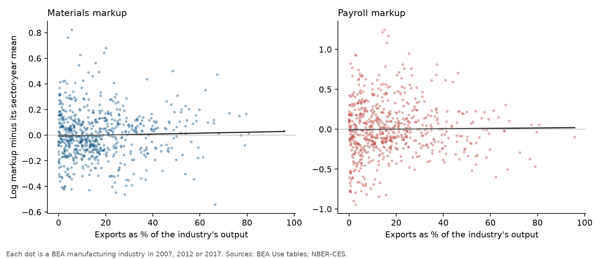
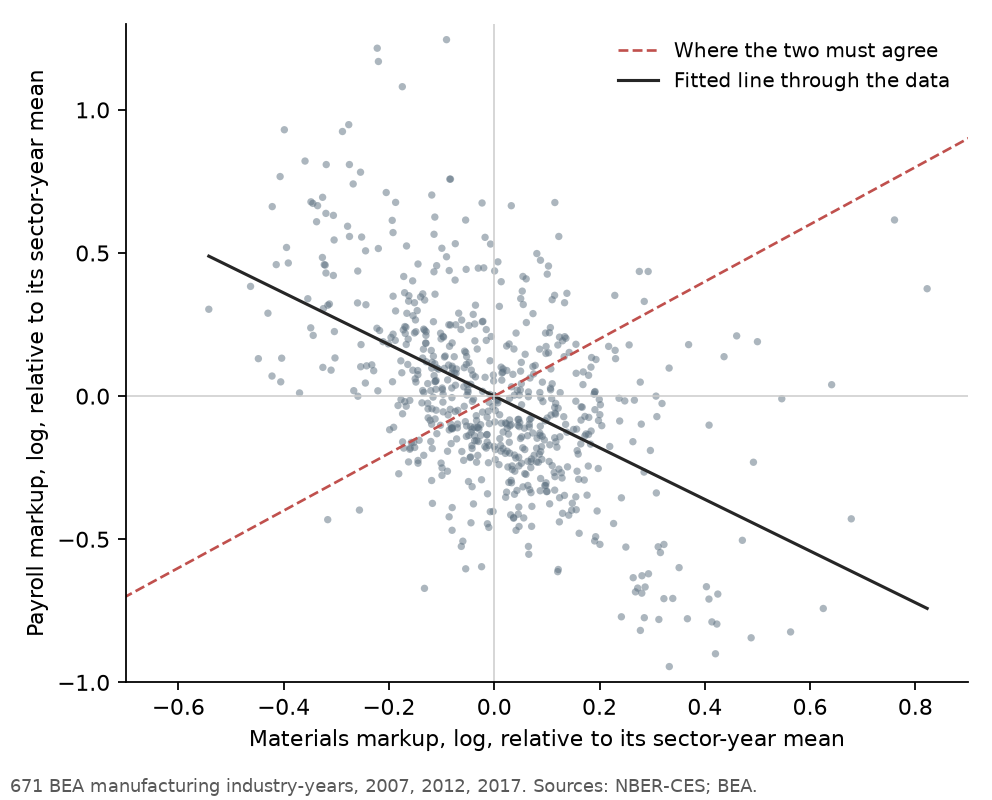
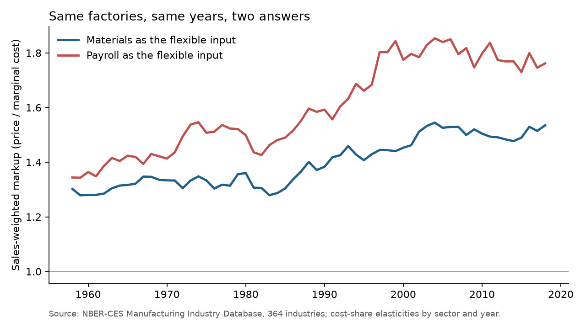

# What American Exporters Charge

### In 2012, Jan De Loecker and Frederic Warzynski showed that Slovenian firms selling abroad charged higher markups than firms that stayed home. I asked the same question of American manufacturing.

---

A load of ready-mix concrete has to be poured within hours of leaving the plant, so almost none of it crosses a
border. In 2017 American plants made $30.7 billion of it and exported $91 million, three tenths of one percent.
Boeing's lines in Everett, Washington, and North Charleston, South Carolina, build airliners for carriers on every
continent. That same year the aircraft industry exported $50.6 billion of the $134.8 billion it produced, more
than a third, and the aircraft engine industry, led by GE Aviation and Pratt & Whitney, sent abroad four of every
five dollars of what it made.

Selling to the world is usually treated as a sign of strength. Exporters are bigger, more productive and better
paid than firms that sell only at home, and trade economists have documented that pattern in country after
country. A harder question is whether exporters also charge more over their costs. If they do, part of what looks
like superior efficiency is pricing power, and the gains from trade are shared differently than the textbooks
suggest. De Loecker and Warzynski built a method to answer that question from ordinary accounting data, and the
method went on to become a standard way economists measure market power.

---

## Two numbers that make a markup

A markup is the ratio of a product's price to the cost of producing one more unit of it.

```math
\mu \equiv \frac{P}{MC}
```

A markup of 1.0 means a company sells at cost. A markup of 1.5 means a widget that costs $1.00 to make at the
margin sells for $1.50. Marginal cost is almost never written down anywhere, which is why markups were hard to
measure for so long.

De Loecker and Warzynski's insight, borrowed from Robert Hall's work in the 1980s, is that a company's markup
can be read off two numbers. The first is the output elasticity of an input the company can adjust freely, such
as materials. It answers the question of how much output rises, in percent, when that input rises by one
percent. The second is how much the company spends on that input as a share of its sales.

```math
\mu_{it} = \frac{\theta^X_{it}}{\alpha^X_{it}}, \qquad \alpha^X_{it} = \frac{P^X_{it} X_{it}}{P_{it} Q_{it}}
```

Here $`\theta^X_{it}`$ is the output elasticity of input $`X`$ for producer $`i`$ in year $`t`$, and
$`\alpha^X_{it}`$ is spending on that input divided by sales. In a competitive market the two are equal and the
markup is 1. When price sits above marginal cost, sales are inflated relative to costs, the spending share falls
below the elasticity, and the gap between them is the markup.

Take American pharmaceutical manufacturing in 2017, the industry of Pfizer and Merck. It spent 28.8 cents of every
sales dollar on materials, and materials account for about 79% of the cost of making drugs (I explain below how that
elasticity is measured). The same arithmetic works with payroll, which took 7.9 cents of each sales dollar and
accounts for about 15% of costs.

```math
\mu^M_{\text{pharma}} = \frac{0.7932}{0.2882} = 2.75, \qquad \mu^L_{\text{pharma}} = \frac{0.1454}{0.0793} = 1.83
```

Both say drugs sell well above the cost of making another bottle, although the two inputs disagree by almost a
full point. The materials version looks like this in three very different industries.

| Industry, 2017 | Materials share of sales | Materials elasticity | Markup |
|---|---|---|---|
| Ready-mix concrete | 53.1% | 0.652 | 1.23 |
| Semiconductors (Intel, Micron, Texas Instruments) | 42.1% | 0.617 | 1.46 |
| Pharmaceutical preparations (Pfizer, Merck) | 28.8% | 0.793 | 2.75 |

The elasticity is the hard part. De Loecker and Warzynski estimated it with a production function. The simpler
alternative, which I use for the reasons given below, sets it equal to the input's share of total cost, which is
exactly right if doubling every input doubles output.

```math
\theta^M_{st} = \operatorname{median}_{i \in s}\ \frac{P^M M_{it}}{P^M M_{it} + W L_{it} + r_t\,P^K K_{it}}
```

The median is taken over industries $`i`$ in the same three-digit sector $`s`$ and year, $`W L`$ is payroll and
$`r_t P^K K`$ is the yearly cost of the capital stock. In 2017 I charge capital at
$`r_t = 0.0233 - 0.0213 + 0.0651 = 0.0671`$, the ten-year Treasury yield minus inflation plus the depreciation
rate implied by the capital data.

---

## Jan De Loecker, Frederic Warzynski and Slovenia

The paper first circulated as an NBER working paper in 2009. Its 2010 revision lists Jan De Loecker at Princeton
and Frederic Warzynski at the Aarhus School of Business of Aarhus University in Denmark. Their data came from the
Slovenian statistical office and covered every manufacturing firm in the country from 1994 to 2000, an unbalanced panel of 7,915 firms. Slovenia
had left Yugoslavia in 1991 and was turning toward Western Europe. The authors report that the number of exporters
grew by 35% over their sample and manufacturing exports by 42%, which gave them hundreds of firms entering
foreign markets.

The formula above follows from one assumption, that a firm picks its freely adjustable inputs to produce its
output at the lowest cost. Write the firm's cost-minimization problem with $`\lambda`$ as the multiplier on the
output target, which is marginal cost, and take the first-order condition for the flexible input $`X`$.

```math
\begin{aligned}
\mathcal{L} &= P^X X + rK + \lambda\big(Q - F(X, K, \omega)\big)\\
0 &= P^X - \lambda\,\frac{\partial F}{\partial X}\\
\frac{\partial F}{\partial X}\,\frac{X}{Q} &= \frac{1}{\lambda}\,\frac{P^X X}{Q}\\
\theta^X &= \frac{P}{\lambda}\cdot\frac{P^X X}{P Q} = \mu\,\alpha^X
\end{aligned}
```

Here $`F`$ is the production function and $`\omega`$ is productivity. No assumption about demand, competition or
returns to scale enters, which is why the method spread so quickly. What it needs is a credible elasticity, and
the paper's econometric contribution was a way to estimate one at the firm level while controlling for
productivity, using a firm's materials purchases as a stand-in for the productivity it can see and the
econometrician cannot.

The headline results, from the revised working paper of October 2010, are below. The published version in the
*American Economic Review* may differ in detail; these are the figures I could read.

| De Loecker and Warzynski, Slovenian manufacturing 1994–2000 | Estimate |
|---|---|
| Median markup, specifications I to VI (Table 2) | 1.10 to 1.28 |
| Exporter markup premium, percent (Section 5.2.1) | about 7.8% |
| Exporter markup premium, level, main specification (Table 3) | 0.163 (s.e. 0.017) |
| Rise in markup on entering export markets (Table 4) | 4.7% (s.e. 1.3%) |

The authors found that the older Hall and Klette methods, which do not control for productivity, detected no
significant exporter premium. They read the result as a warning that part of the famous exporter productivity premium
is really a price premium.

The method has since carried a great deal of weight. De Loecker, Jan Eeckhout and Gabriel Unger applied it to
American public companies in the *Quarterly Journal of Economics* in 2020 and reported that the average markup
rose from 21% above marginal cost in 1980 to 61% by the time of their study, a finding that set off a wide debate
about market power. Two critiques followed that go to the root of the method. Steve Bond, Arshia Hashemi, Greg Kaplan and
Piotr Zoch (2021) showed that when output is measured as revenue rather than physical units, the estimated elasticity
absorbs the markup and the ratio collapses toward 1. Devesh Raval (2023) noticed that the formula holds for any
flexible input, so materials and labor must give the same markup, and found in several countries that they do
not. Both critiques matter for any economist or antitrust agency that wants to read market power off company
accounts.

---

## How I tested it

Firm-level export records for the United States exist, but they sit inside the Census Bureau's restricted research
data centers. The closest public substitute is the industry. I combined two free sources. The NBER-CES
Manufacturing Industry Database, maintained by Randy Becker, Wayne Gray and Jordan Marvakov, reports shipments,
materials, payroll, employment, capital and price deflators for 364 six-digit manufacturing industries from
1958 to 2018. The Bureau of Economic Analysis input-output Use tables report exports and total output for each
manufacturing commodity in 2007, 2012 and 2017. I mapped the 364 industries to 225 BEA industries with the BEA's
own NAICS concordance, giving 671 industry-years. In each year I called an industry export-oriented if its export
share was above that year's median, because close to half of the paper's Slovenian firms exported (2,335 of
4,906 in 2000, by its Table 1).

I first tried the paper's own estimator, a production function fitted separately for each three-digit sector with
materials as the productivity proxy. On the industry panel it returned at least one elasticity below zero or above
one in 10 of 21 sectors, with materials elasticities ranging from −2.40 to 1.21. That instability is a known
property of the estimator when the flexible input is also the proxy. I set it aside and used cost shares by sector
and year. Under the paper's Cobb-Douglas technology the elasticity is common to every industry in a sector, so the
log markup splits into a sector-year part and an industry part.

```math
\ln \mu^X_{it} = \ln \theta^X_{s(i)t} - \ln \alpha^X_{it}
```

Sector-by-year fixed effects absorb the first term, which means the exporter comparison does not depend on how the
elasticity is estimated, a point the authors make themselves in Section 6.1 of the working paper. The test is
the paper's equation (17), with the same labor and capital controls and the same kind of industry-by-year
dummies, here at the level of the three-digit sector.

```math
\begin{aligned}
\ln \mu^X_{it} &= \delta_0 + \delta_1\,\text{EXP}_{it} + \gamma_1 \ln L_{it} + \gamma_2 \ln K_{it}\\
&\quad + \lambda_{s(i)t} + \varepsilon_{it}, \qquad H_0:\ \delta_1 = 0
\end{aligned}
```

$`\text{EXP}_{it}`$ is the export-oriented dummy (or the export share), $`L`$ is employment, $`K`$ the real
capital stock and $`\lambda_{s(i)t}`$ a sector-year effect. Standard errors are clustered by BEA industry. For the
paper's second test, whether markups rise when exporting rises, I replace the sector-year effects with
industry and year effects.

```math
\ln \mu^X_{it} = \beta\,\text{EXP}_{it} + \gamma_1 \ln L_{it} + \gamma_2 \ln K_{it} + \eta_i + \tau_t + u_{it}
```

I ran everything twice, once with materials and once with payroll as the flexible input. That is Raval's test,
and it is the extension.

---

## Export-oriented industries do not charge higher markups

| Flexible input | Export-oriented vs. the rest | 10 points more export share | Industry-years |
|---|---|---|---|
| Materials | +0.6% (s.e. 2.8%) | +1.0% (s.e. 0.9%) | 671 |
| Payroll | +1.4% (s.e. 4.7%) | −2.6% (s.e. 1.5%) | 671 |

In formal terms, the main estimates are these.

```math
\begin{aligned}
\hat{\delta}_1^{M} &= 0.006\ (0.028),\quad 95\%\ \text{CI}\ [-0.048,\ 0.060],\quad N = 671\\
\hat{\delta}_1^{L} &= 0.014\ (0.047),\quad 95\%\ \text{CI}\ [-0.079,\ 0.106],\quad N = 671
\end{aligned}
```

Neither is distinguishable from zero. With materials, the confidence interval stops at 6.0%, below the 7.8% premium
the paper found in Slovenia, so a premium of that size is ruled out in the main specification. With payroll the
interval is wide enough to include it. The answer holds when I weight industries by their shipments, use only
2017, define export-oriented as the top third, or replace the Census input shares with the BEA's own figures for
intermediate inputs and employee compensation. None of the sixteen versions in
[results/premium_cross_section.csv](results/premium_cross_section.csv) is significant at the 5% level.



Across American manufacturing, an industry that ships half its output abroad carries about the same markup as a
neighbor in its sector that sells almost entirely at home. This is a comparison of industries, and the paper's
claim is about firms within an industry, so the two results do not contradict each other. Inside aircraft
manufacturing, Boeing may well price differently from a small domestic parts shop. What the data rule out is the
idea that the industries most exposed to foreign buyers are, as a group, the ones with pricing power.

---

## Selling more abroad did not raise markups within an industry

The paper's most striking result was dynamic. Slovenian firms' markups rose by about 4.7% when they started
exporting. The industry version asks whether an industry's markup rose between 2007, 2012 and 2017 as its export
share rose.

| Flexible input | 10 points more export share | Becoming export-oriented |
|---|---|---|
| Materials | −1.5% (s.e. 1.7%) | −5.3% (s.e. 2.9%) |
| Payroll | −6.7% (s.e. 3.1%) | −5.9% (s.e. 3.4%) |

All four estimates point down, the opposite direction from the paper, and only the payroll estimate on the export
share clears the 5% level (p = 0.034). Only 24 of the 225 industries crossed the median in either direction over
the decade, so the dummy version rests on few cases, and the payroll result loses significance when I use the
BEA's compensation figures instead. The fair reading is that the data show no sign of markups rising with exports
and a weak sign that they fell.

---

## Materials and payroll disagree about which industries have pricing power

If the production approach is right, the two inputs must tell the same story. Within a sector, Raval's restriction
says the two log markups should move one for one.

```math
\frac{\theta^M_{st}}{\alpha^M_{it}} = \frac{\theta^L_{st}}{\alpha^L_{it}} \quad\Longrightarrow\quad \operatorname{corr}\big(\widetilde{\ln \mu^M_{it}},\ \widetilde{\ln \mu^L_{it}}\big) = 1
```

The tilde marks a log markup measured relative to its sector-year mean. The data give the opposite sign.

```math
\hat{\rho} = -0.50,\quad \text{Spearman } -0.47,\quad N = 671
```

In 66% of industry-years one input puts the industry above its sector's average markup and the other puts it
below, worse than the 50% that coin flips would produce. The negative correlation is the same in 2007 (−0.55),
2012 (−0.53) and 2017 (−0.40). Raval reported negative correlations of the same kind in firm-level manufacturing
data from several countries and in store-level data from a large American retailer, so it is unlikely to be a
quirk of aggregation.



The country's largest exporters show how far apart the two answers can be.

| Industry, 2017 | Leading companies | Exports | Export share | Materials markup | Payroll markup |
|---|---|---|---|---|---|
| Aircraft | Boeing | $50.6 billion | 38% | 2.10 | 1.52 |
| Aircraft engines | GE Aviation, Pratt & Whitney | $34.5 billion | 80% | 1.60 | 1.27 |
| Light trucks and SUVs | Ford, GM, Fiat Chrysler, Toyota | $30.4 billion | 14% | 1.09 | 4.46 |
| Basic organic chemicals | Dow, ExxonMobil Chemical | $27.8 billion | 24% | 1.26 | 2.35 |
| Plastics resins | Dow, LyondellBasell | $26.2 billion | 30% | 1.22 | 2.09 |
| Semiconductors | Intel, Micron, Texas Instruments | $23.1 billion | 46% | 1.46 | 1.46 |
| Pharmaceutical preparations | Pfizer, Merck | $22.1 billion | 15% | 2.75 | 1.83 |
| Semiconductor machinery | Applied Materials, Lam Research | $11.3 billion | 79% | 1.31 | 0.97 |
| Ready-mix concrete | Hundreds of local producers | $0.1 billion | 0.3% | 1.23 | 1.89 |

*Companies are the well-known leaders of each industry; the data are industry totals and do not name firms.*

Light truck assembly is the extreme case. Materials take 74.6% of sales and payroll only 3.8%, because an
assembly plant buys most of a pickup in finished parts. By materials, Ford's and GM's truck plants barely cover
cost. By payroll, they charge almost four and a half times marginal cost. Semiconductor machinery runs the other
way, with a payroll markup below 1, a reading that would have Applied Materials and Lam Research selling below
cost. Semiconductors are one of the few large exporters where the two agree.

A likely cause is that industries in the same sector differ in how they combine labor and materials, and
the method assumes they share one technology. An industry that buys more of its parts shows a low materials
markup and a high payroll markup, and one that makes more in-house shows the reverse. The difference in technology
gets recorded as a difference in pricing power, with the sign set by whichever input the researcher picked.

For the exporter test, the bias appears to work the same way in export-oriented and domestic industries. A
direct test of whether the two inputs give different export premiums finds a gap of 0.8 points (s.e. 6.9 points,
p = 0.91), so both put the premium near zero even though their industry rankings are negatively correlated.

---

## Both measures say manufacturing markups have risen since 1958



On the questions where aggregation smooths out industry differences, the two inputs come closer. Weighted by
sales, the materials markup rose from 1.30 in 1958 to 1.53 in 2018 and the payroll markup from 1.34 to 1.76.
Both rise, and both put the median industry near 1.43 to 1.45 in 2017, against 1.10 to 1.28 in Slovenia. The
gap between them has widened, though, because payroll fell from 24.0% of manufacturing sales in 1958 to 13.2% in
2018 while materials held near 53%. A researcher who believed payroll would report a large rise in market power;
one who believed materials would report a moderate one. My levels also run higher than the paper's because the
Census materials figure leaves out purchased services such as advertising, software and legal work, so measured
costs are too low.

---

## Why it matters

For consumers, the result is mildly reassuring. The industries that compete hardest for foreign buyers do not
charge American customers a premium over cost relative to their neighbors, which is what one would expect if
selling abroad means facing Airbus, Siemens and Samsung every day.

For workers, the payroll results deserve care. The fall in payroll's share of sales is real and large, and it is
the same fact that economists studying the declining labor share have documented. Reading that fall as rising
markups and reading it as automation and outsourcing are different claims, and this method alone cannot tell them
apart.

For trade policy, the export-premium story was one reason to think exporting raises productivity. The industry
data give no support to the idea that becoming more export-oriented raises markups, so measured productivity gains
in exporting industries are less likely to be price effects in disguise, at least at this level of aggregation.

For antitrust, the lesson is about the tool. Markups estimated from accounting data now figure in policy debates
about market power. Those estimates can change by a factor of four depending on which input the analyst chooses, as
light trucks show, so any such number should come with the same calculation done on a second input.

---

## Limits of this study

The paper compared firms, and I compare industries, because American firm-level export data are confidential.
Exporters within an industry may still charge more than non-exporters, and nothing here tests that. The BEA export
figures are counted by commodity rather than by the plant that made the goods, and may include some goods made
abroad and shipped on, which would overstate the export share of a few industries. The NBER-CES capital series
ends in 2016, so 2017 uses the 2016 stock. My elasticities come from cost shares, which assume constant returns to
scale, the assumption the paper's method was designed to avoid, and the paper's own estimator failed on this panel. Output is deflated with
industry price indexes rather than measured in physical units, so the Bond critique applies with less force than
it does to firm revenue, but it still applies. And the export comparisons are correlations, not causal effects.

---

## Further reading

- [TECHNICAL.md](TECHNICAL.md) has the data, the method, every test statistic and how to reproduce the results.
- [results/FINDINGS.md](results/FINDINGS.md) has a plain-English summary and every table the scripts produce.
- [METHODS_REVIEW.md](METHODS_REVIEW.md) is a methods and statistical-reporting review of the original paper.
- The original paper is Jan De Loecker and Frederic Warzynski, "Markups and Firm-Level Export Status,"
  *American Economic Review* 102(6), 2012, pp. 2437–2471. The working paper version is NBER Working Paper 15198
  (2009, revised 2010).
- Devesh Raval, "Testing the Production Approach to Markup Estimation," *Review of Economic Studies* 90(5), 2023,
  pp. 2592–2611.
- Steve Bond, Arshia Hashemi, Greg Kaplan and Piotr Zoch, "Some Unpleasant Markup Arithmetic: Production Function
  Elasticities and Their Estimation from Production Data," *Journal of Monetary Economics* 121, 2021, pp. 1–14.
- The data are the NBER-CES Manufacturing Industry Database, 2021 release, NAICS 2012 version
  (data.nber.org/nberces); the BEA detailed Use table before redefinitions, producers' prices, 2007, 2012 and 2017
  (apps.bea.gov, AllTablesIO.zip); FRED series GS10 and CPIAUCSL. All downloaded November 1, 2026.

*Brendyn Beasley*
